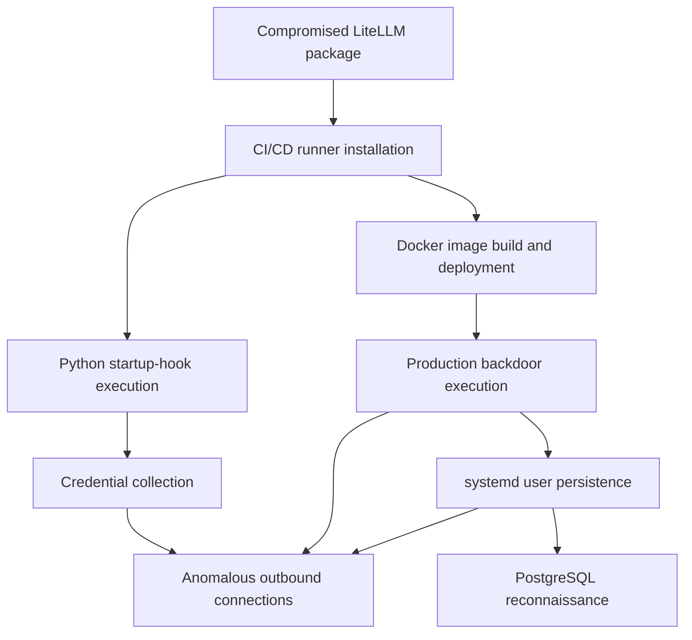

# Operation IRONSPINE — Investigation Report

**Analyst:** Maxim Bondarchuk  
**Prepared:** 23 November 2026  
**Project type:** Threat-hunting lab simulation  
**Method:** AI-assisted investigation and documentation, with findings checked against supplied telemetry  
**Workspace:** LAW-HuntPractice  
**Run identifier:** is-214-20261024  
**Investigation window:** 24 October 2026, 14:00–16:00 UTC  

## Overview

This investigation examines a simulated LiteLLM supply chain compromise at NovaBridge Analytics.

A scheduled dependency update installed the backdoored `litellm` package on a CI/CD runner. The investigation traced execution through a Python startup hook, propagation into a production Docker deployment, credential harvesting, persistence, anomalous outbound connections, and PostgreSQL reconnaissance.

The analysis covered **6,766 events across seven telemetry tables**.

## Environment

| Host | IP address | Role |
|---|---|---|
| nb-cicd01 | 10.7.0.10 | CI/CD runner |
| nb-app01 | 10.7.0.20 | Production application server |
| nb-db01 | 10.7.0.30 | PostgreSQL database |

### Telemetry reviewed

| Table | Events |
|---|---:|
| DeviceProcessEvents_CL | 1,563 |
| DeviceNetworkEvents_CL | 2,432 |
| DeviceFileEvents_CL | 3 |
| DeviceLogonEvents_CL | 194 |
| CICDPipeline_CL | 280 |
| PackageAudit_CL | 25 |
| Syslog | 2,269 |
| **Total** | **6,766** |

Custom tables were scoped with:

~~~kusto
| where RunId == "is-214-20261024"
~~~

Syslog required:

~~~kusto
| where RunId_CF == "is-214-20261024"
~~~

## Investigation Objectives

- Identify the dependency update that introduced the compromised package.
- Establish how the backdoor executed.
- Trace propagation from the CI/CD runner to production.
- Identify credential collection and persistence.
- Separate anomalous connections from legitimate API traffic.
- Investigate database access and suspicious queries.
- Document response priorities and visibility limitations.

## Executive Findings

The `weekly-dependency-update` pipeline job upgraded `litellm` from **1.82.6 to 1.82.8** on `nb-cicd01`.

The installation created `litellm_init.pth` in Python’s site-packages directory. A later pytest interpreter spawned an encoded Python subprocess that launched credential-collection commands and contacted `198.51.100.44:443`.

The CI/CD pipeline subsequently built and pushed the `analytics-api` Docker image. Production pulled that image and launched an application interpreter, which spawned the same encoded-execution command pattern.

The production backdoor created `sysmon.py` and a systemd user service. The persistent process then connected to PostgreSQL using the `app_svc` account. Database audit records showed schema enumeration, broad table reads, and a CSV export statement.

Code execution was established on the CI/CD and application hosts. The database showed credential-backed access and suspicious SQL, but the supplied evidence did not establish an operating-system implant on the database host.

## Attack Progression

## Timeline

All timestamps below are UTC.

| Time | Host | Event |
|---|---|---|
| 14:15:00.000 | nb-cicd01 | `weekly-dependency-update`, job `run-8847`, checks out revision `a3f7c1e` |
| 14:15:22.000 | nb-cicd01 | Pipeline records installation of `litellm 1.82.8` |
| 14:15:25.283 | nb-cicd01 | Package audit records upgrade from `1.82.6` to `1.82.8` |
| 14:15:26.186 | nb-cicd01 | `pip` creates `litellm_init.pth` |
| 14:22:47.000 | nb-cicd01 | Python PID `3020` starts pytest |
| 14:22:49.205 | nb-cicd01 | Child Python PID `3021` executes an encoded command |
| 14:22:50–14:23:07 | nb-cicd01 | Credential-collection commands execute |
| 14:24:16.819 | nb-cicd01 | PID `3021` connects to `198.51.100.44:443` |
| 14:25:33.269 | nb-cicd01 | Docker builds `analytics-api:latest` |
| 14:25:42.124 | nb-cicd01 | Docker pushes the image |
| 14:25:44.519 | nb-app01 | Production pulls the image |
| 14:26:38.925 | nb-app01 | Gunicorn starts as Python PID `3060` |
| 14:26:43.488 | nb-app01 | Child Python PID `3061` executes the encoded command pattern |
| 14:26:50.702 | nb-app01 | First observed production connection to `198.51.100.44:443` |
| 14:26:58.859 | nb-app01 | `sysmon.py` is created |
| 14:27:02.989 | nb-app01 | `sysmon.service` is created |
| 14:27:06.439 | nb-app01 | The systemd user service is enabled and started |
| 14:28:44.000 | nb-app01 | User systemd launches `sysmon.py` as PID `3070` |
| 14:28:47.214 | nb-app01 | PID `3070` connects to PostgreSQL |
| 14:28:50.204 | nb-db01 | PostgreSQL records a connection from `10.7.0.20:51200` |
| 14:28:51.179 | nb-db01 | PostgreSQL authorizes `app_svc` |
| 14:28:55–14:28:56 | nb-db01 | Database catalog enumeration begins |
| 14:31:56–14:32:14 | nb-db01 | Broad data reads and further schema/role enumeration occur |
| 14:32:17.831 | nb-app01 | `gzip` processes `/tmp/.nb/dump.csv` |
| 14:32:20.362 | nb-app01 | `base64` processes `/tmp/.nb/dump.csv.gz` |
| 14:35:20–14:35:39 | nb-app01 | Five further connections reach the anomalous destination |
| 14:35:26–14:35:39 | nb-db01 | Queries target API keys, export customers, and retrieve analytics results |
| Approximately 15:00 | nb-app01 | Resource-exhaustion alert described in the case handoff |

### Measured Intervals

| Comparison | Elapsed time |
|---|---:|
| Pipeline installation record → package audit record | 3.283 seconds |
| Package audit record → first CI/CD backdoor subprocess | 7 minutes 23.922 seconds |
| First CI/CD backdoor subprocess → first production backdoor subprocess | 3 minutes 54.283 seconds |
| Package audit record → first production backdoor subprocess | 11 minutes 18.205 seconds |

Production backdoor execution preceded the approximate 15:00 alert by about **33 minutes**.

## 1. Supply Chain Entry

The relevant pipeline job was:

- **Job name:** `weekly-dependency-update`
- **Job ID:** `run-8847`
- **Repository:** `NovaBridge/analytics-platform`
- **Revision:** `a3f7c1e`

The pipeline output reported downloading and installing `litellm 1.82.8`. Package audit records independently identified:

| Property | Value |
|---|---|
| Package | litellm |
| Previous version | 1.82.6 |
| Installed version | 1.82.8 |
| Source | PyPI |
| Action | Upgrade |
| HashVerified | true |

`HashVerified=true` did not establish that the package was safe. Integrity verification must be combined with trusted release provenance and approved dependency versions.

### Supporting Query

~~~kusto
CICDPipeline_CL
| where RunId == "is-214-20261024"
| where JobId == "run-8847"
| project TimeGenerated, JobName, JobId, StepName, StepOutput, JobStatus
| order by TimeGenerated asc
~~~

~~~kusto
PackageAudit_CL
| where RunId == "is-214-20261024"
| where PackageName == "litellm"
| project TimeGenerated, Computer, PackageName, PreviousVersion,
          Version, Source, Action, HashVerified
~~~

## 2. Backdoor Execution

The installation created:

~~~text
/opt/venv/lib/python3.11/site-packages/litellm_init.pth
~~~

The file-create event attributed this action to `pip`, PID `3010`.

The first matching encoded subprocess appeared on `nb-cicd01` at **14:22:49.205 UTC**:

~~~text
python3 -c "exec(__import__('base64').b64decode(b'Li4u'))"
~~~

Its parent was the pytest interpreter:

~~~text
python3 -m pytest tests/ -v --tb=short
~~~

This supports activation when a later interpreter processed the affected environment’s startup hook.

Unrelated Python jobs were present during the installation-to-execution interval. The finding is therefore about startup in the affected environment, rather than a complete absence of Python activity.

The logged encoded command contains a placeholder or shortened payload. Matching command patterns across hosts does not prove byte-for-byte identity of the underlying malware.

### Supporting Query

~~~kusto
DeviceProcessEvents_CL
| where RunId == "is-214-20261024"
| where DeviceName in ("nb-cicd01", "nb-app01")
| where ProcessCommandLine contains "base64"
    or ProcessCommandLine contains "sysmon"
| project Timestamp, DeviceName, ProcessId, ProcessCommandLine,
          InitiatingProcessId, InitiatingProcessCommandLine
| order by Timestamp asc
~~~

## 3. Propagation Into Production

The process and pipeline records supported this deployment sequence:

1. The runner built `registry.novabridge.io/analytics-api:latest`.
2. The runner pushed the image.
3. Production pulled the same repository/tag.
4. Gunicorn started on `nb-app01`.
5. Gunicorn spawned the encoded Python subprocess.

Pipeline records also showed `docker-build`, `docker-push`, and `deploy-production` under `run-8847`.

This supports propagation through the CI/CD Docker deployment.

Separate SSH and rsync records included routine release synchronization and service restarts. Those commands alone did not establish malicious SSH-based lateral movement.

## 4. Credential Collection

The production backdoor launched commands targeting these files:

~~~text
/srv/analytics/.env
/home/app_svc/.aws/credentials
/home/app_svc/.docker/config.json
/srv/analytics/.git/config
~~~

Related activity on the runner targeted its project environment file, AWS credentials, Docker configuration, and Git configuration.

The process records show collection commands being invoked. They do not contain returned file contents or command exit statuses.

For response purposes, accessible secrets should be treated as exposed.

## 5. Persistence

Two persistence files were created on `nb-app01`:

~~~text
/home/app_svc/.config/sysmon/sysmon.py
/home/app_svc/.config/systemd/user/sysmon.service
~~~

The backdoor then executed:

~~~text
systemctl --user enable --now sysmon.service
~~~

User systemd subsequently launched:

~~~text
python3 /home/app_svc/.config/sysmon/sysmon.py
~~~

This linked file creation, service enablement, and execution of the persistent process.

### Supporting Query

~~~kusto
DeviceFileEvents_CL
| where RunId == "is-214-20261024"
| project Timestamp, DeviceName, ActionType, FileName, FolderPath,
          InitiatingProcessFileName, InitiatingProcessId
| order by Timestamp asc
~~~

## 6. Network Baseline and Anomalous Traffic

The case handoff identified the suspicious endpoint as `models.litellm.cloud`. The supplied event records identified the associated investigation IP as:

~~~text
198.51.100.44:443
~~~

The export did not independently provide a DNS resolution binding that hostname to the address.

### Repeated API Destinations

| Destination | Connections from nb-app01 |
|---|---:|
| 104.18.6.192 | 101 |
| 104.18.7.192 | 109 |
| 160.79.104.10 | 112 |
| 160.79.104.20 | 132 |
| 20.150.68.12 | 106 |
| **Total** | **560** |

These destinations appeared before compromise and continued throughout the investigation window.

The anomalous production destination first appeared at **14:26:50.702 UTC**, after backdoor execution. It was absent from the supplied pre-compromise baseline.

### Traffic Discriminator

Both legitimate proxy traffic and the backdoor used:

- Process name: `python3`
- Executable path: `/usr/bin/python3`
- Account: `app_svc`
- Destination port: `443`

The initiating process ID separated the observed traffic groups:

| Traffic | Initiating process IDs |
|---|---|
| Anomalous production connections | 3061, 3070 |
| Repeated provider-destination connections | 14060, 19159, 22282, 22618, 23225, 25911, 26149, 27536 |

All seven production connections to `198.51.100.44` came from backdoor PIDs `3061` or `3070`.

Process IDs must be interpreted with host and time context.

### Destination Count

Under the challenge’s counting rule, `python3` on `nb-app01` contacted **14 distinct remaining addresses** after excluding:

- The internal `10.0.0.0/8` network.
- The anomalous address `198.51.100.44`.

The count includes the cloud metadata endpoint `169.254.169.254`, as required by the scenario.

### Supporting Queries

~~~kusto
DeviceNetworkEvents_CL
| where RunId == "is-214-20261024"
| where RemoteIP == "198.51.100.44"
| project Timestamp, DeviceName, InitiatingProcessId,
          InitiatingProcessFileName, LocalIP, LocalPort,
          RemoteIP, RemotePort
| order by Timestamp asc
~~~

~~~kusto
DeviceNetworkEvents_CL
| where RunId == "is-214-20261024"
| where DeviceName == "nb-app01"
| where InitiatingProcessFileName == "python3"
| where not(ipv4_is_in_range(RemoteIP, "10.0.0.0/8"))
| where RemoteIP != "198.51.100.44"
| distinct RemoteIP
| summarize DestinationCount = count(),
            Destinations = make_set(RemoteIP)
~~~

## 7. Database Reconnaissance

Persistent Python PID `3070` connected from:

~~~text
10.7.0.20:51200 → 10.7.0.30:5432
~~~

PostgreSQL recorded the same source endpoint and authorized `app_svc`.

This tied the database session to the compromised production host. Reuse of harvested application database credentials is the supported explanation, although the actual password or connection-string contents were not captured.

### Queries That Deviated From Normal Activity

Normal application queries commonly used selected columns, parameters, customer-specific filters, and routine writes.

The anomalous sequence included:

~~~sql
SELECT table_name, table_schema
FROM information_schema.tables
WHERE table_schema = 'public';

SELECT schemaname, tablename, n_live_tup
FROM pg_stat_user_tables
ORDER BY n_live_tup DESC;

SELECT * FROM customers LIMIT 5000;

SELECT * FROM user_accounts;

SELECT email, api_key_hash, role
FROM user_accounts
WHERE role = 'admin';

SELECT * FROM pg_catalog.pg_roles WHERE rolcanlogin;

SELECT * FROM api_keys WHERE revoked = false;

COPY (SELECT * FROM customers) TO STDOUT WITH CSV;
~~~

Two characteristics stood out:

1. Schema and role enumeration through system catalogs.
2. Broad, unparameterized reads and bulk export activity.

### Information at Risk

The queries targeted:

- Database schemas and table names.
- Column names and data types.
- Estimated table populations.
- Login-role metadata.
- Customer information.
- Analytics results.
- User-account information.
- Active API-key records.

The catalog queries could help an attacker identify valuable tables and construct targeted extraction queries.

The audit export contains statements, not result sets. A `LIMIT 5000` clause does not prove that 5,000 records were returned or stolen.

### Supporting Query

~~~kusto
Syslog
| where RunId_CF == "is-214-20261024"
| where Computer == "nb-db01" and ProcessName == "postgres"
| where SyslogMessage contains "information_schema"
    or SyslogMessage contains "pg_stat_user_tables"
    or SyslogMessage contains "pg_catalog"
    or SyslogMessage contains "SELECT *"
    or SyslogMessage contains "api_key_hash"
    or SyslogMessage contains "COPY ("
| project TimeGenerated, SyslogMessage
| order by TimeGenerated asc
~~~

## Exfiltration Assessment and Limitations

Credential-collection processes and the persistent backdoor established successful connections to the anomalous address. Database queries and processing of `dump.csv` also supported collection and staging activity.

However, the network records contained connection metadata rather than:

- Captured application payloads.
- HTTP request bodies or verbs.
- Transfer sizes.
- Server receipts.
- Decryption material.

Public malware analysis describes **AES-256-CBC encryption with an RSA-4096-protected session key**. This is threat-intelligence context, rather than a cipher independently recovered from the lab’s network records.

**The exact exfiltrated contents cannot be recovered from the supplied network telemetry alone.**

Other limitations include:

- No complete malware sample or persistence-file contents.
- No full malicious-image digest.
- No confirmed query result sets or exact stolen-record count.
- No evidence establishing an operating-system backdoor on `nb-db01`.
- Limited historical baseline coverage.
- No detailed CPU, memory, or container-restart history establishing the resource spike’s precise cause.

## Root Cause and Attribution

Public reporting describes `hackerbot-claw` abusing a Trivy GitHub Actions workflow to obtain a privileged token.

Trivy releases/actions were subsequently poisoned. The reported likely route into LiteLLM involved theft of its PyPI publishing credentials when compromised tooling ran in its pipeline. TeamPCP then published backdoored LiteLLM releases.

The local evidence begins with NovaBridge installing `litellm 1.82.8`. It supports the downstream execution and deployment chain but does not independently validate the upstream credential theft.

The estate’s root cause was trust in a compromised upstream dependency within an automated update and deployment process.

## Indicators and Investigation Pivots

| Type | Indicator |
|---|---|
| Package version | `litellm 1.82.8` |
| Startup hook | `/opt/venv/lib/python3.11/site-packages/litellm_init.pth` |
| Persistence script | `/home/app_svc/.config/sysmon/sysmon.py` |
| Persistence service | `/home/app_svc/.config/systemd/user/sysmon.service` |
| Domain from case handoff | `models.litellm.cloud` |
| Investigation IP | `198.51.100.44` |
| Deployment artifact | `registry.novabridge.io/analytics-api:latest` |
| Image tag / revision pivot | `a3f7c1e` |
| Execution behavior | Python startup hook and encoded subprocess |
| Persistence behavior | systemd user-service enablement |
| Collection behavior | Credential-file reads and broad database queries |

Tags and process IDs are investigation pivots, rather than globally unique malware signatures.

## Remediation Priorities

These recommendations were developed from the investigation. No production remediation was performed.

| Priority | Recommended Action | Risk Addressed |
|---|---|---|
| 1 | Isolate affected CI/application workloads, pause compromised deployments, block the anomalous destination, and preserve evidence | Continued communication, collection, and propagation |
| 2 | Revoke and rotate accessible database, cloud, registry, Git/CI, and model-provider secrets from a clean environment | Reuse of exposed credentials |
| 3 | Remove the malicious package/startup hook and sysmon persistence; rebuild affected environments and images from trusted inputs | Persistent execution and contaminated artifacts |
| 4 | Pin approved dependencies and immutable actions/images; verify provenance and restrict CI permissions | Another supply chain compromise |
| 5 | Apply database least privilege, protect secrets, review suspicious queries, and restrict unnecessary network access | Further data access and theft |

## Investigation Lessons

- Package integrity checks do not establish that a release is trustworthy.
- A malicious dependency can propagate through an otherwise routine deployment.
- Installation time and first execution time can differ.
- Process names and destination ports can match legitimate activity.
- Host, timestamp, process lineage, and network correlation provide stronger context.
- Database audit logs can reveal downstream use of compromised application access.
- Investigation reports should distinguish observed behavior from inferred impact.

## Evidence Integrity

The final supplied export was:

- **Filename:** `New query (2).csv`
- **Size:** 3,964,335 bytes
- **SHA-256:**

~~~text
7b13fa00124d5f25e768bb58ea6d97726b6fde4cd94cb7ce0cfd387527e5ff15
~~~

The queries above require access to the original lab dataset.

## References

- [Semgrep — The TeamPCP credential-infostealer chain reaches Python’s LiteLLM](https://semgrep.dev/blog/2026/the-teampcp-credential-infostealer-chain-attack-reaches-pythons-litellm/)
- [LiteLLM — Security Update: Suspected Supply Chain Incident](https://docs.litellm.ai/blog/security-update-march-2026)

Public reporting provides context. Estate-specific findings are based on the supplied RunId-scoped telemetry and case handoff.
